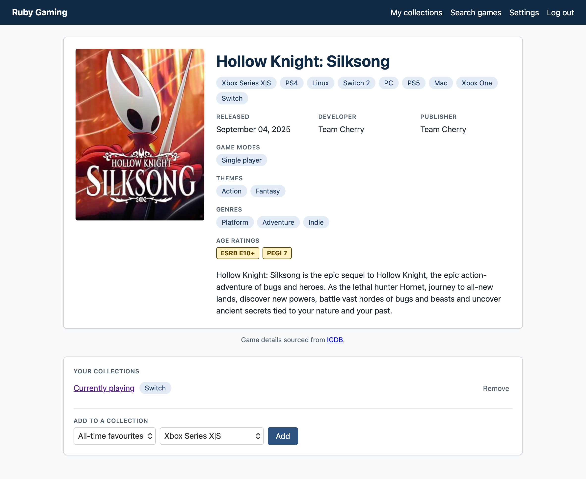
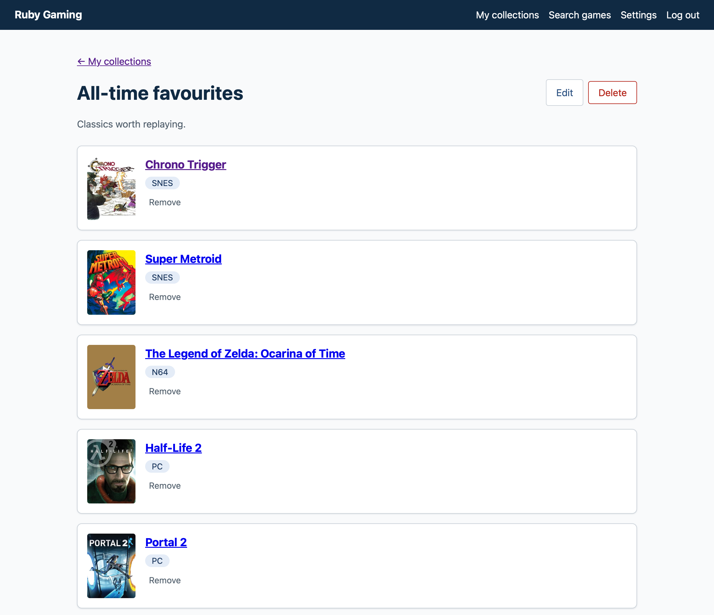
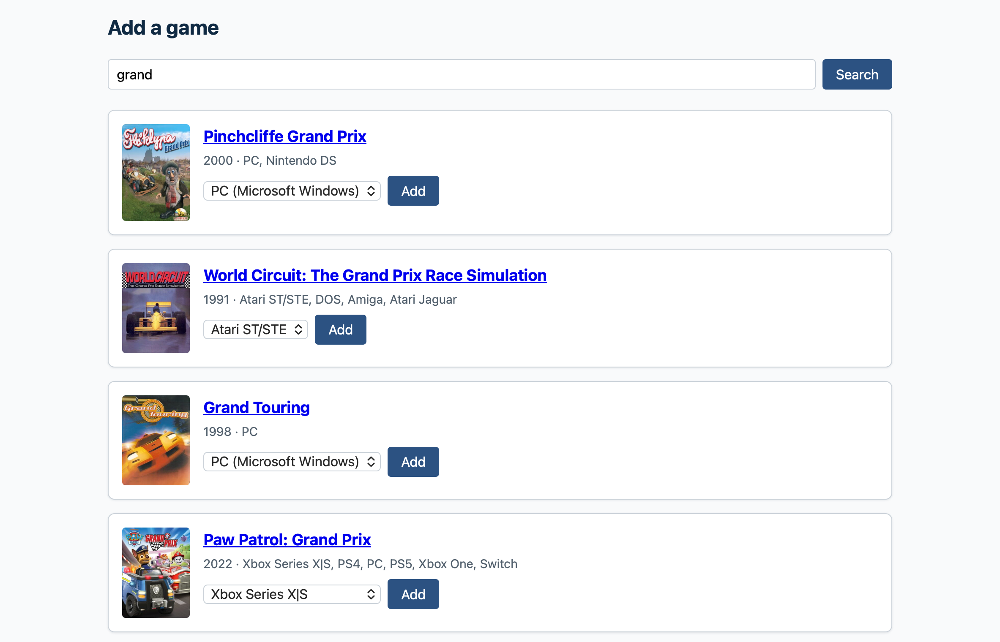
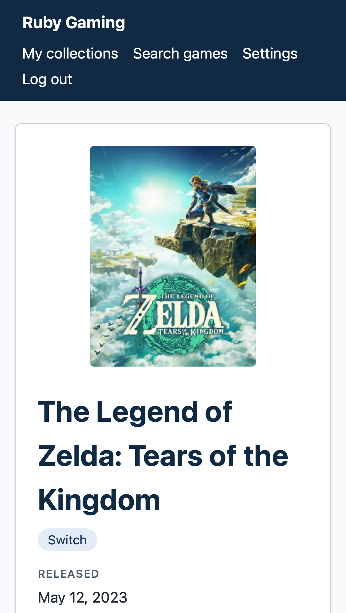

# Ruby Gaming

A Rails 8.1 app for tracking the games you own or want: search IGDB, then sort
games into your own collections by platform.



<p>
  
  
  
</p>

<!-- TODO: ~30 second screencap. -->

## Why this project

I built this to keep my skills sharp for the work I want to keep doing: senior
backend or full-stack engineering on APIs, integrations and AI-enabled
products. It also let me learn a new framework (Rails) properly, and keep
refining how I work day to day with AI tooling.

## What it demonstrates

- **Full-stack Rails 8.1** with Hotwire (Turbo, Stimulus) and PostgreSQL.
- **Third-party API integration:** IGDB through Twitch OAuth, with a local
  cache that cuts down on API calls and keeps working when the API is down.
- **Authentication and per-user data:** every page requires login, and users
  can't reach each other's records.
- **Testing at three levels:** unit, HTTP-level integration and real-browser
  system tests.
- **CI and security scanning** on every PR: tests, RuboCop, Brakeman and
  dependency audits.
- **AI-assisted workflow:** built with Claude Code, with working conventions
  written down and refined over time.
- **Planning and scoping:** feature planning, work breakdown and vertical
  slices.

## How it was built

Work is planned in `.claude/PLAN.md`, finished work is logged in
`.claude/HISTORY.md`, and `.claude/HANDOFF.md` records where things stand so
a session can resume cold. Each story gets its own branch and pull request,
with small commits and green tests at every commit. I used Claude Code as a
pairing partner throughout; the working agreements it follows are in
`CLAUDE.md`.

## Run it locally

You need Ruby (see `.ruby-version`) and Postgres
(`brew services start postgresql@17` on a Mac).

**IGDB access:** you can browse the seeded demo with no credentials. Live game
search, and viewing any game that isn't already cached, needs a free Twitch
developer account and an IGDB client ID and secret
([IGDB API docs](https://api-docs.igdb.com/#account-creation)). The app reads
them from Rails encrypted credentials under `igdb:` (`client_id`,
`client_secret`). The repo's encrypted file needs a key that isn't published,
so on your own copy run `rm config/credentials.yml.enc` and then
`bin/rails credentials:edit` to create your own. Don't commit that file.

```
bin/setup                  # install gems, prepare the database
bin/rails db:seed          # load the demo data (see "Demo data" below)
bin/rails server           # run the app at http://localhost:3000
```

### Demo data

`bin/rails db:seed` loads IGDB's top 100 games (a static snapshot in
`db/seeds/games.yml`, so it needs no IGDB credentials) and a demo user with
three populated collections. It is safe to run repeatedly and refuses to run
in production.

Log in with:

```
email:    demo@example.com
password: demo-password-123
```

### Other commands

```
bin/rails test             # model, integration and service tests (no browser)
bin/rails test:system      # browser tests (Capybara + headless Chrome)
bin/rails test:all         # everything above
bin/rails test path/to/file_test.rb:LINE   # one file, or one test by line

RUN_IGDB_INTEGRATION=1 bin/rails test test/services/igdb_client_live_test.rb
                           # opt-in smoke test against the live IGDB API
                           # (needs real credentials; skipped by default)

bin/rubocop                # style check
bin/brakeman               # security scan
bin/ci                     # CI run: setup, rubocop, security audits, tests, seeds
                           # (system tests are not included; see config/ci.rb)
```

Rails "integration tests" (`test/integration/`) are plain HTTP-level tests
with no browser, so they run as part of `bin/rails test`. Only system tests
need `test:system`.

## What's next

**Features**

- Screenshots and trailers on the game details page.
- Ratings and play status.
- Reviews, from short takes to longer write-ups with screenshots.
- Discussion boards.
- News feed.
- Friends and a social feed.

**Platform**

- Overall visual theme.
- Email verification and stronger rate limiting on sign-in.
- Hosting.

## Let's talk

If you'd like to talk about this project, the way I work, or working
together, find me on [LinkedIn](https://www.linkedin.com/in/jasonbgarland).
